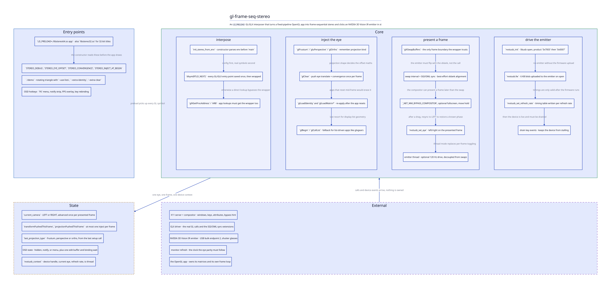

# gl-frame-seq-stereo

An `LD_PRELOAD` GL/GLX interposer that gives old fixed-pipeline OpenGL games frame-sequential stereo and drives an NVIDIA 3D Vision IR emitter in step with the buffer swap.

Read it left to right:

- **It never owns the frame — it edits what the app already drew.** The constructor grabs every GL/GLX entry point with `dlsym(RTLD_NEXT)` (and wraps `glXGetProcAddress`/`ARB`, otherwise a direct symbol lookup silently bypasses the wrapper), records the projection kind in `glFrustum`/`gluPerspective`/`glOrtho`, then pushes one eye translation plus convergence rotation at the start of a frame and pops it before the swap. The eye offset maths follows the projection shape, which is why the projection calls are hooked at all.
- **`glClear` is the frame hook, and `glLoadIdentity` is the patch on top of it.** Injection happens in `glClear` because that is the first call after the previous swap for most fixed-pipeline titles; but an app that calls `glLoadIdentity` mid-frame erases the pushed transform, so `glLoadIdentity`/`glLoadMatrix*` re-apply the eye offset while the per-frame push is active. For display-list apps like glxgears, where neither fires per vertex, `glBegin`/`glCallList` are the last-resort path.
- **Presenting is the hard part, not rendering.** `glXSwapBuffers` is the only boundary the wrapper trusts: it negotiates the swap interval, prefers SGI/OML vblank sync, sets `_NET_WM_BYPASS_COMPOSITOR` (and optionally EWMH fullscreen) so the compositor stops adding a frame of latency, then flips the emitter on the frame that is actually presented. `Drawbacks.md` is the honest list of what still drifts when the compositor holds a frame.
- **Window drags are a special case, not an edge case.** Moving or resizing a window makes the compositor redirect the window and delay presentation, so during a 240 ms move-hold the swap path stops sequencing eyes, does raw swaps only, and resyncs to LEFT when movement stops — otherwise the shutters end up half a frame out of phase.
- **The emitter is a USB device with firmware, not a display.** `nvstusb.c` opens the 3D Vision controller (`0x7003`, falling back to `0x0007`), uploads the 6 KB `nvstusb.fw`, writes a timing table for the current refresh rate, and only then toggles the eye (`0xAA`). It runs either synchronously at swap time or from a background thread at ~120 Hz, and it must be drained for key events or the device stalls.

Diagram source: [`docs/system.d2`](docs/system.d2) · renderer: [`scripts/render-diagram.sh`](scripts/render-diagram.sh).
